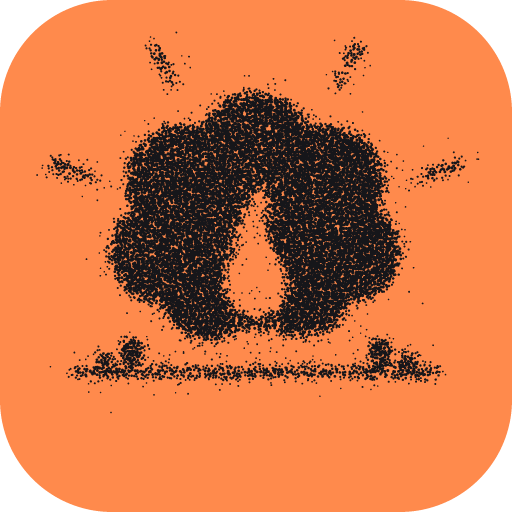
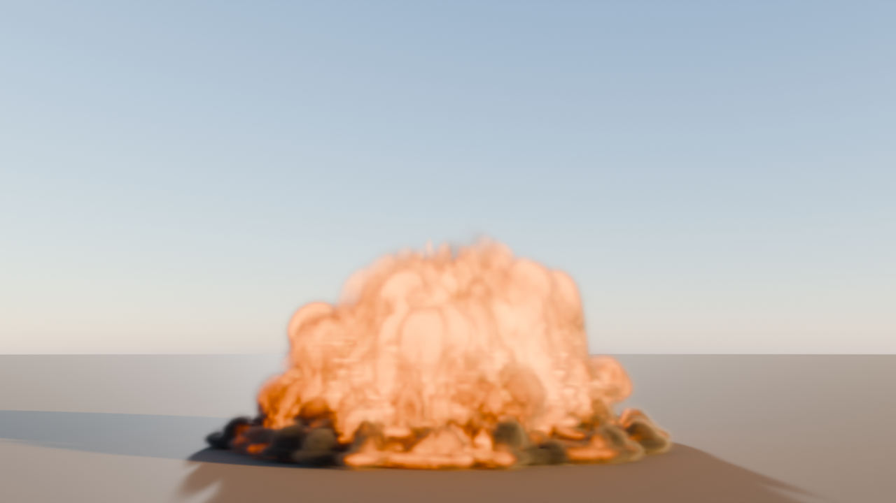
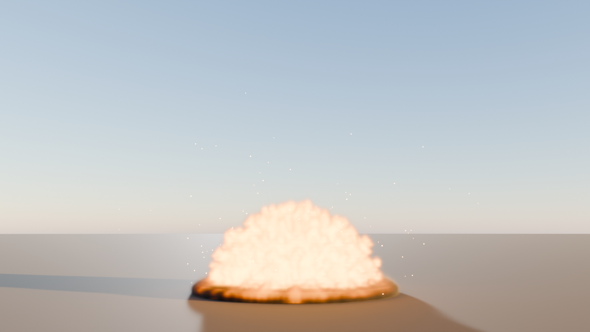
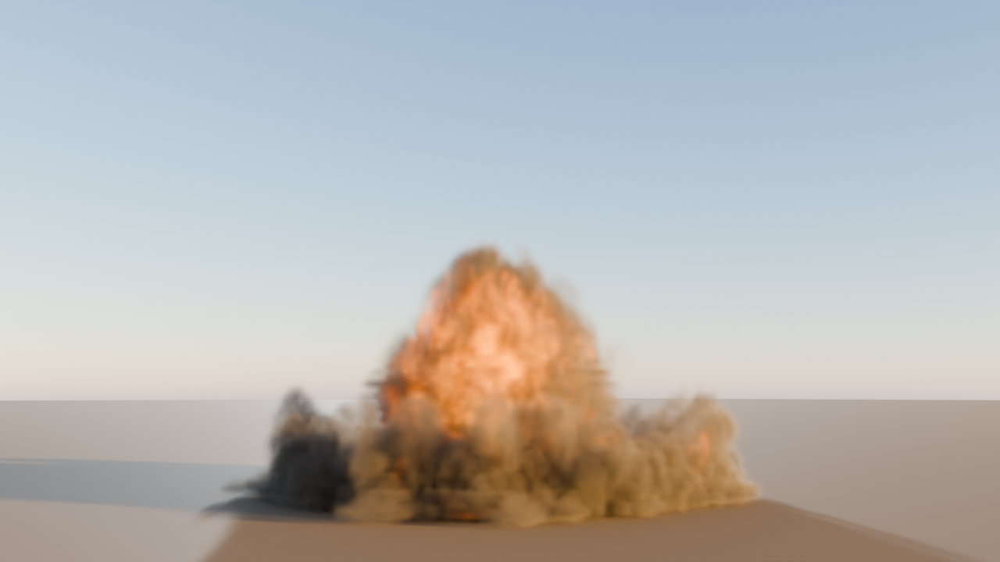
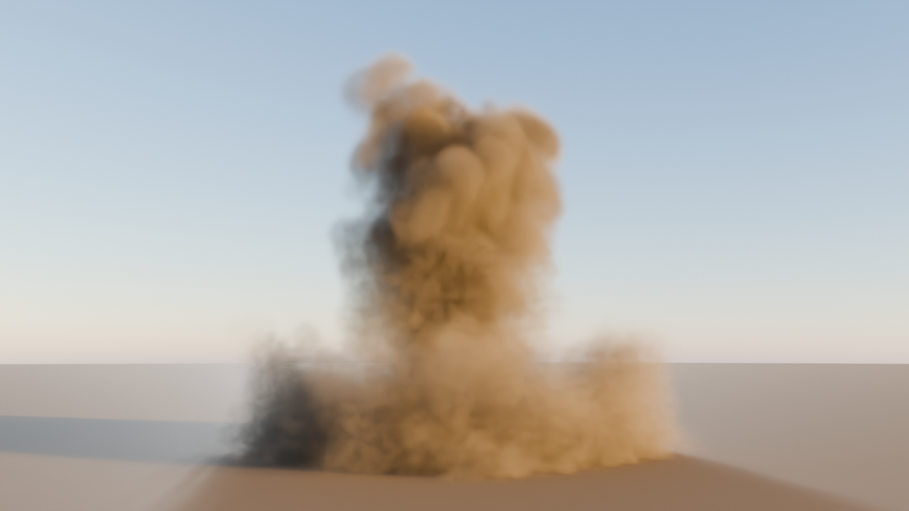
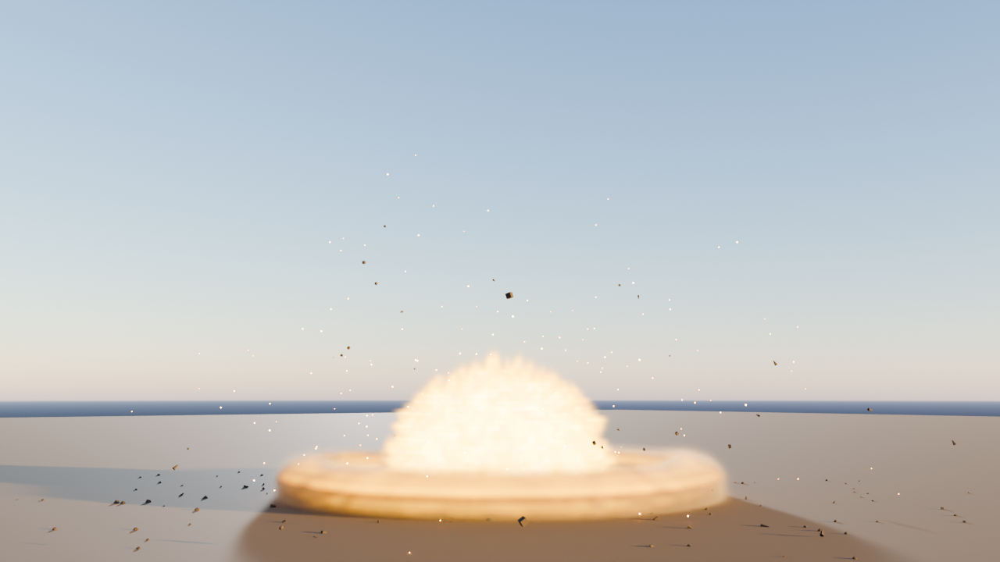
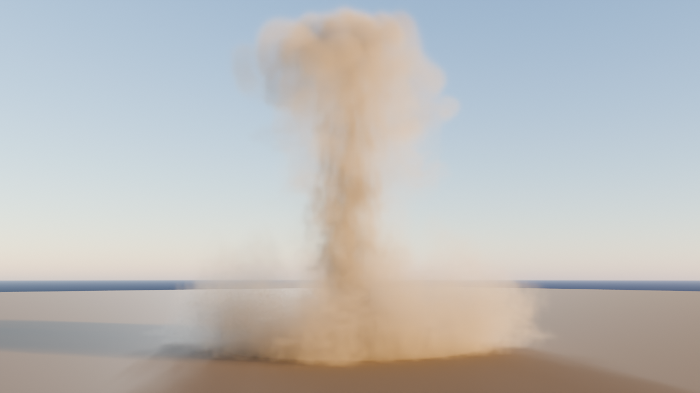

<h1>&nbsp;BlastFX</h1>

**Procedural cinematic explosions for Blender** — part of [OpenSimFX](https://github.com/opensimfx),
alongside RainFX, FlowFX and AtmosFX.



| | |
|---|---|
|  |  |
|  |  |



_Renders: desktop Blender 5.2.3, Cycles, Preview quality, 64 samples with denoising, 1280 x 720, straight from
`tools/render_preview.py` with a low evening sun over sand (command below). Each preset is baked once and rendered
at several moments of the shot; about a minute per frame on an Apple M4. No compositing._

BlastFX builds an explosion from three physical settings: the fireball size, the playback speed and the shot
length. One click creates the whole stack: a Mantaflow gas domain sized to the event, the fireball burst, a rising
column, ground surge, shock-raised dust, debris, fire light, a sound-delayed camera shake, exposure and bloom, and
heat distortion. The solver is scaled by Froude similarity, so a 4 m charge and a 170 m nuclear fireball both look
right and only their real-world timing differs. Bakes run in a background Blender process, and caches are
content-addressed: nothing re-bakes unless something that affects the simulation changed.

> BlastFX is a **visual simulation system**. It produces cinematic explosions; it is not an engineering model of
> real blasts, yields or damage.

## Features

- **Scale-correct physics**: every blast runs as a reference-sized model with a Froude-scaled solver time, so
  buoyancy, burst speed and burn rate hold at any size ([docs/PHYSICS.md](docs/PHYSICS.md)).
- **Five explosion types, 7 presets**: charge, fuel/vehicle, large and heavy ground blasts, nuclear air and
  ground bursts ([docs/PRESETS.md](docs/PRESETS.md)); save your own as JSON.
- **Physically shaded fire and smoke**: emission follows Kirchhoff's law with a blackbody colour, and smoke
  optical depth is normalised by the fireball size, so small blasts are not see-through and big ones not opaque.
- **Cinematic layer**: fire light, camera shake delayed by the speed of sound, exposure and bloom, heat-distortion
  shell and a refraction shock ring, all timed from the same event.
- **Quality tiers**: Draft, Preview and Final change only resolution, noise and solver accuracy, never the event;
  Final matches Draft within a few percent. Preview bakes about 2.5x faster than Final.
- **Background bakes you can trust**: one worker at a time, cancel-safe, with progress and time remaining; the
  cache identity covers every input, so stale caches are detected instead of shown.

## Install

Requires Blender **5.2 LTS** (Mantaflow gas).

BlastFX is sold on [**Gumroad**](https://arshth.gumroad.com/l/blastfx); GitHub releases no longer carry the zip.
The source here is GPL-3.0, so you can build it yourself:

```bash
python tools/build_extension.py        # -> dist/blastfx-<version>.zip
```

In Blender: *Edit > Preferences > Get Extensions > (v) > Install from Disk...*, pick the zip. The panel appears in
the 3D Viewport sidebar (**N**) under **BlastFX**.

## Quick start

1. Open the **BlastFX** tab, pick a preset and press **Create Blast** (it starts at the 3D cursor).
2. Open **Cache and Bake**, keep **Draft** and press **Bake Simulation**; scrub the timeline.
3. Adjust Explosion, Components and Look, then **Rebuild Blast** with the controller selected.
4. Bake at **Preview** to judge the look and **Final** for the shot, then render with Cycles.

Full walkthrough: [docs/USER_GUIDE.md](docs/USER_GUIDE.md).

## Verification status (read this)

Verified on **desktop Blender 5.2.3 LTS, macOS arm64**:

- 72 pure-Python tests: Froude scaling, solver configuration, profiles, presets, burst timing, cache identity and
  recovery, batch bake queue, domain envelope, ground placement.
- Every preset goes through Create, Rebuild, Duplicate and Remove in Blender; every panel draws and references
  only registered properties and operators.
- Bakes and renders reviewed at Draft and Preview for every preset, and at Final for consistency with Draft
  (flame and smoke within 4-7%); measurements are in [docs/VALIDATION.md](docs/VALIDATION.md).
- Final-quality bakes of all seven presets at their full size bake and render with no errors, on an Apple M4
  CPU: 14 min (Small) to about 3.5 h (Heavy). Times per preset are in docs/VALIDATION.md.
- The built zip passes Blender's extension validator and installs, enables and creates a blast in a clean profile.

**Not verified** - treat as unknown:

- Blender versions other than 5.2.3; Windows and Linux; GPU Cycles; EEVEE.
- Blasts larger than ~400 m: the solver's time-scale limit makes them rise a little slower than real (the panel
  warns, the Nuclear presets are ~9% short).
- Headless batch workflows outside the add-on's own background worker.

## Repository layout

```
blastfx/                 the add-on (this folder is what the extension zip contains)
  core/                  pure Python, no bpy: physics, Froude scaling, profiles, blast plan, solver config, cache
  simulation/            Mantaflow domain, burst particles, column, dust, shock ring, ground collider
  materials/             volume shading (blackbody fire, smoke), rapatronic skin
  animation/             cinematic layer: fire light, camera shake, exposure, heat distortion, shock ring
  addon/  ui/            properties, operators, registration; sidebar panels
  presets/  render/      factory presets; render settings
  utils/                 naming, logging, Blender API compatibility
docs/                    user guide, presets, physics, system design, development, validation, references, roadmap, UI style
tests/                   pytest suites (pure Python, no bpy)
tools/                   build_extension, render_preview, gen_preset_docs, validation and benchmarks
presets/                 saved JSON presets (loaded on start)
examples/                example scenes
```

## Develop

```bash
python -m pytest                                  # pure tests, no Blender
BLENDER=/Applications/Blender.app/Contents/MacOS/Blender
$BLENDER -b --python tools/blender_runtime_smoke_test.py          # Mantaflow bake + render smoke test
$BLENDER -b --python tools/physics_validation.py                  # physics wiring checks
$BLENDER -b --factory-startup --python tools/render_preview.py -- medium docs/img/medium.png 64 PREVIEW 0.15
# README renders: one bake, several moments, evening light (writes docs/img/medium_<moment>.png)
BLASTFX_W=1280 BLASTFX_H=720 BLASTFX_SUN=6 BLASTFX_SUN_AZ=150 BLASTFX_GROUND=0.12,0.09,0.06 BLASTFX_CAM=12 \
  BLASTFX_CAM_UP=1.2 BLASTFX_AGX=1 BLASTFX_CAMFX=0 BLASTFX_MOMENTS=0.08,0.2,0.45 \
  $BLENDER -b --factory-startup --python tools/render_preview.py -- medium docs/img/medium.png 64 PREVIEW
python tools/gen_preset_docs.py                   # regenerate docs/PRESETS.md
python tools/build_extension.py                   # dist/blastfx-<version>.zip
```

Mantaflow bakes need desktop Blender; the `bpy` wheel crashes inside the solver. See
[docs/DEVELOPMENT.md](docs/DEVELOPMENT.md).

## Documentation

[User guide](docs/USER_GUIDE.md) · [Presets](docs/PRESETS.md) · [Physics](docs/PHYSICS.md) ·
[System design](docs/SYSTEM_DESIGN.md) · [Development](docs/DEVELOPMENT.md) · [Validation](docs/VALIDATION.md) ·
[References](docs/REFERENCES.md) · [Roadmap](docs/ROADMAP.md) · [UI style](docs/UI_STYLE.md) · [Changelog](CHANGELOG.md)

## Contributions

This project does not accept contributions.

## License

GPL-3.0-or-later — see [LICENSE](LICENSE).
